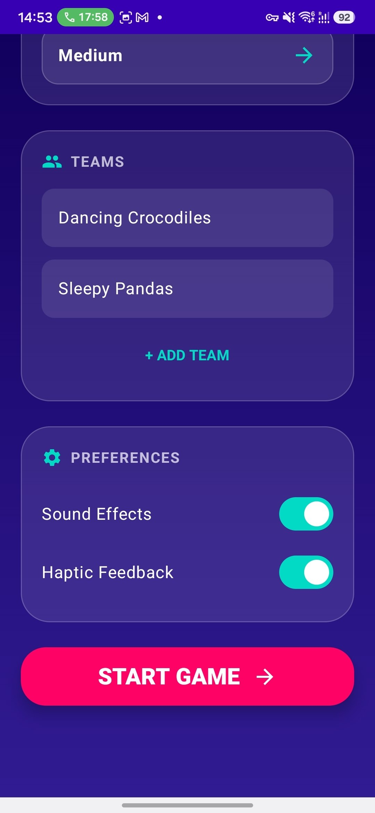
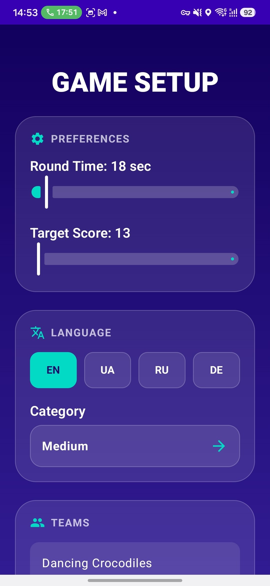
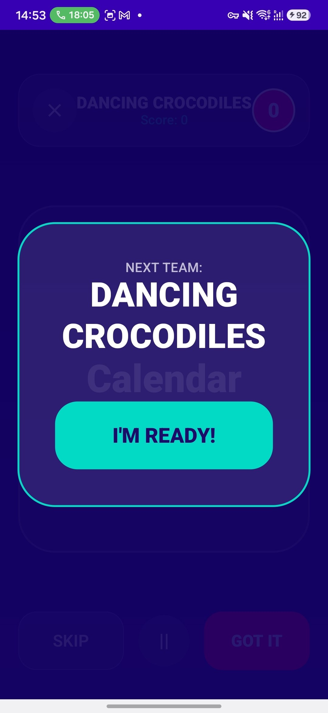
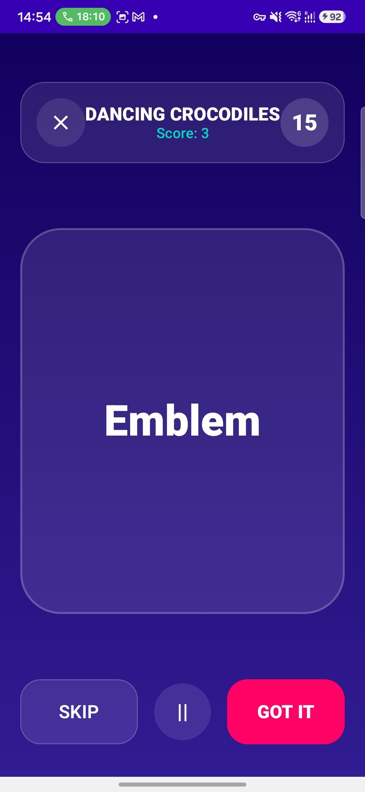
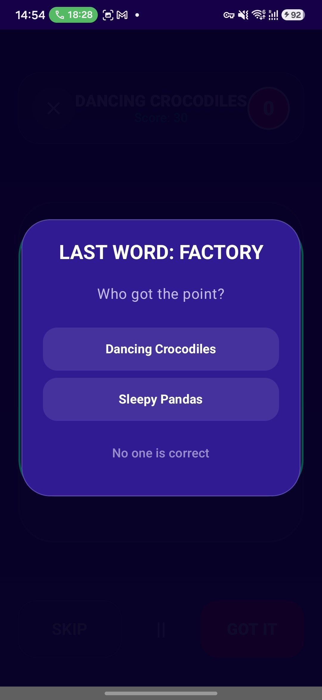
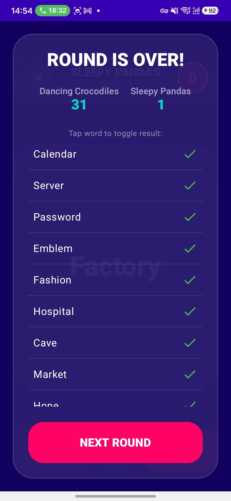
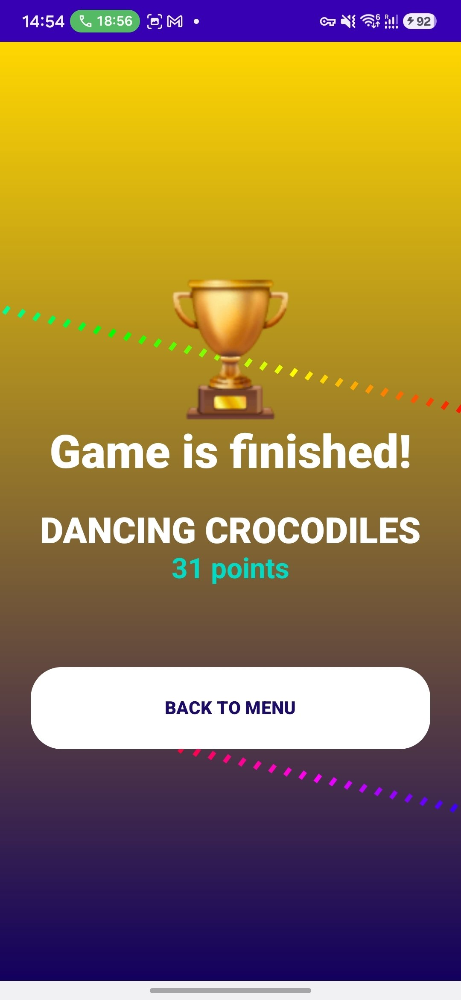

# Alias Game

Alias Game is an Android party game inspired by the word-guessing game Alias. It is built with **Kotlin** and **Jetpack Compose**.

## Features

- **Flexible game setup:** set the round duration and target score; add, rename, and remove teams.
- **Localized word packs:** choose English, Ukrainian, Russian, or German, then select a difficulty category whose words are loaded from local JSON assets.
- **Timed team turns:** start and pause or resume a countdown for each team.
- **Word scoring:** mark words as correct or skipped with vertical card swipes or on-screen buttons.
- **Last-word decision:** when the timer expires, award the final word to a team or mark it as unclaimed.
- **Round review:** review each word's result after a round and correct a result before continuing.
- **Fair game completion:** every team gets a turn in the round cycle before the game can end; tied top-scoring teams can win together.
- **Optional feedback:** enable or disable sound effects and haptic feedback.
- **Saved preferences:** language, word pack, team names, round duration, target score, sound, and haptic settings are persisted with DataStore.

## Tech Stack

- **Language:** Kotlin
- **UI:** Jetpack Compose
- **Architecture:** Clean Architecture layers in a single Gradle module (`:app`), with ViewModels in the presentation layer
- **Dependency injection:** Hilt
- **Asynchronous state:** Kotlin Coroutines and Flow
- **Preferences:** Jetpack DataStore Preferences
- **Navigation:** Navigation Compose
- **Word data:** localized JSON assets

## Architecture

The app is organized into three Clean Architecture layers within the `:app` module:

- **Presentation:** Compose screens and ViewModels that expose UI state.
- **Domain:** game models, use cases, repository interfaces, and the framework-independent `GameEngine`.
- **Data:** repository implementations for DataStore preferences and JSON word packs.

This is a layered structure inside one Gradle module, not a multi-module project.

## Preferences and Word Data

DataStore stores the small set of user preferences, including game settings and team names. Its Flow-based API lets the presentation layer observe preference changes. Word packs are bundled as localized JSON assets and loaded locally.

## Screenshots

Screenshots below are stored in the repository under `docs/` and use relative paths.

### Setup

  

### Categories

The category selector is part of the setup screen; the repository does not include a separate screenshot of the category list.

  

### Gameplay

<table>
  <tr>
    <td align="center"><strong>Ready to start</strong> </td>
    <td align="center"><strong>Word card</strong> </td>
    <td align="center"><strong>Last word</strong> </td>
  </tr>
</table>

### Results

<table>
  <tr>
    <td align="center"><strong>Round results</strong> </td>
    <td align="center"><strong>Game winner</strong> </td>
  </tr>
</table>

## Testing

The repository currently contains:

- **6 dedicated `GameEngine` unit tests** covering scoring, turn rotation, fair play, draws, and correcting word results.
- **1 template arithmetic unit test** (`2 + 2`).
- **1 template instrumented test** that checks the app package name.
- **No dedicated UI tests** currently exist.

## Continuous Integration

The GitHub Actions workflow runs `lintDebug`, `testDebugUnitTest`, and `assembleDebug` on its configured push and pull-request events. It does **not** run instrumented tests; `connectedAndroidTest` is not part of the workflow.

## Getting Started

1. Clone the repository.
2. Open the project in Android Studio.
3. Configure JDK 17 for Gradle.
4. Sync the project and run the `:app` module on an emulator or physical device.

## Roadmap

- [ ] Add dedicated automated UI tests for setup and gameplay flows.
- [ ] Expand unit-test coverage to word loading, settings persistence, and presentation logic.
- [ ] Improve diagnostics and recovery for missing or malformed word-pack assets.
