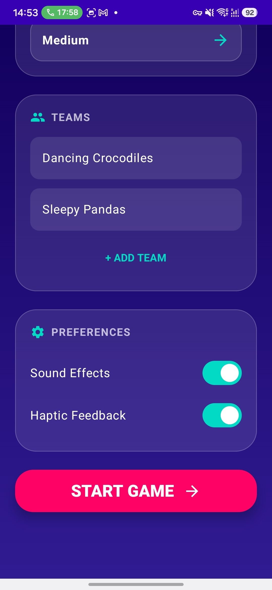
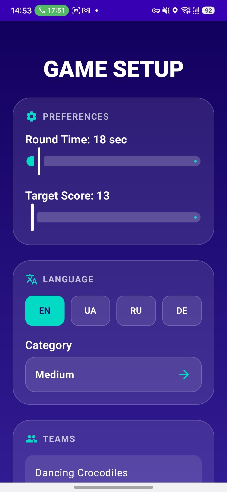
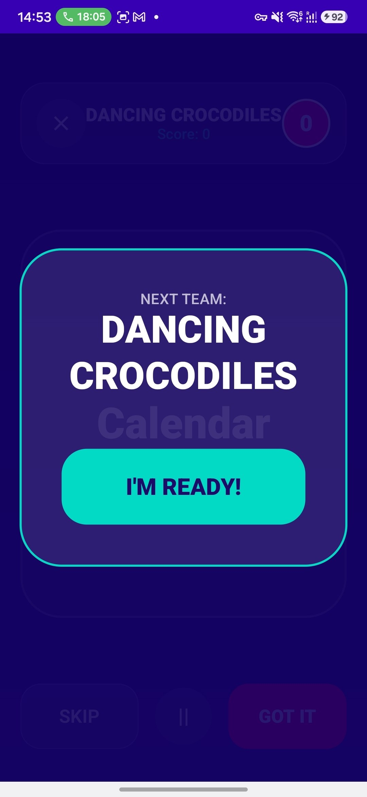
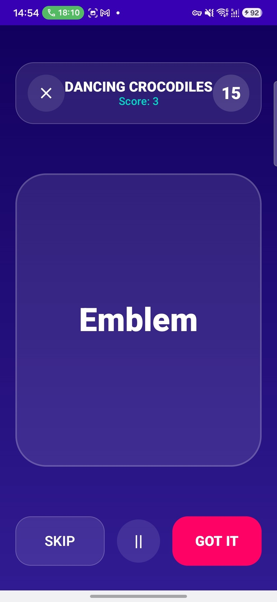
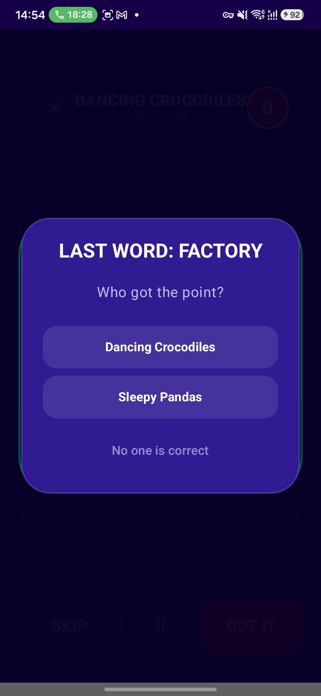
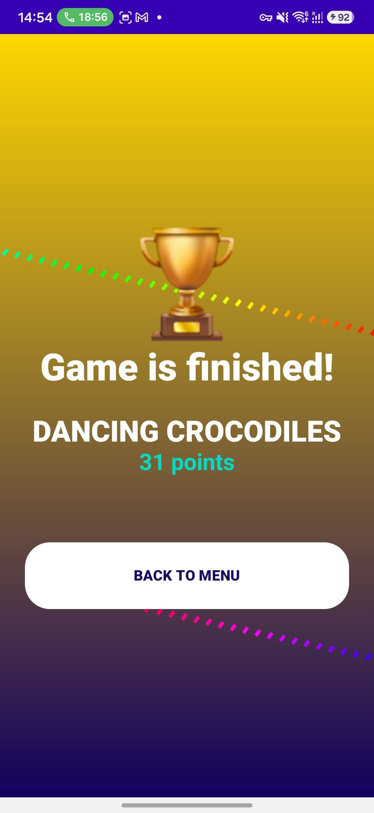

# Alias Game

Alias Game is an Android party game inspired by the word-guessing game Alias. It is built with **Kotlin** and **Jetpack Compose**.

## Features

- **Flexible game setup:** set the round duration and target score; add, rename, and remove teams.
- **Localized word packs:** choose English, Ukrainian, Russian, or German, then select a difficulty category whose words are loaded from local JSON assets.
- **Timed team turns:** start and pause or resume a countdown for each team; it pauses automatically when you leave the app.
- **Resumable games:** an interrupted game is restored in the same state, even after the system kills the app.
- **Word scoring:** mark words as correct or skipped with vertical card swipes or on-screen buttons.
- **Last-word decision:** when the timer expires, award the final word to a team or mark it as unclaimed.
- **Round review:** review each word's result after a round and correct a result before continuing.
- **Fair game completion:** every team gets a turn in the round cycle before the game can end; tied top-scoring teams can win together.
- **Optional feedback:** enable or disable sound effects and haptic feedback.
- **Saved preferences:** language, word pack, team names, round duration, target score, sound, and haptic settings are persisted with DataStore.

## Tech Stack

- **Language:** Kotlin
- **UI:** Jetpack Compose
- **Architecture:** Clean Architecture layers in a single Gradle module (`:app`), with ViewModels in the presentation layer
- **Dependency injection:** Hilt
- **Asynchronous state:** Kotlin Coroutines and Flow
- **Preferences:** Jetpack DataStore Preferences
- **Navigation:** Navigation Compose
- **Word data:** localized JSON assets

## Architecture

The app is organized into three Clean Architecture layers within the `:app` module:

- **Presentation:** Compose screens and ViewModels that expose UI state.
- **Domain:** game models, use cases, repository interfaces, and the framework-independent `GameEngine`.
- **Data:** repository implementations for DataStore preferences, the saved game session, and JSON word packs.

This is a layered structure inside one Gradle module, not a multi-module project.

### Game state machine

A game is always in exactly one `GamePhase`, and `GameEngine` owns every transition:

```text
READY_TO_START --start--> RUNNING --pause--> PAUSED --resume--> RUNNING
RUNNING --time runs out--> LAST_WORD --decide last word--> ROUND_REVIEW or FINISHED
ROUND_REVIEW --next round--> READY_TO_START
```

Every engine command is validated against the current phase, so stray or repeated taps cannot put the game into an invalid state. The engine has no Android dependencies and is covered by plain JVM tests.

### Game sessions

The setup screen starts a game by saving a fresh session snapshot; the game screen's ViewModel creates its own `GameEngine` from the saved session. Starting a new game and restoring one after process death therefore follow the same code path. The session is saved after every change, and a turn that was running when the app was killed is restored paused. The countdown also pauses when the app goes to the background (but not on rotation).

## Preferences and Word Data

DataStore stores the small set of user preferences, including game settings and team names. Its Flow-based API lets the presentation layer observe preference changes. Word packs are bundled as localized JSON assets, read off the main thread and cached per language. The app language is applied with AppCompat per-app locales and persists across restarts on all supported Android versions.

## Screenshots

Screenshots below are stored in the repository under `docs/` and use relative paths.

### Setup

<p align="center">
  
</p>

### Categories

The category selector is part of the setup screen; the repository does not include a separate screenshot of the category list.

<p align="center">
  
</p>

### Gameplay

<table>
  <tr>
    <td align="center"><strong>Ready to start</strong><br></td>
    <td align="center"><strong>Word card</strong><br></td>
    <td align="center"><strong>Last word</strong><br></td>
  </tr>
</table>

### Results

<table>
  <tr>
    <td align="center"><strong>Round results</strong><br></td>
    <td align="center"><strong>Game winner</strong><br></td>
  </tr>
</table>

## Testing

**Unit tests** (`app/src/test`, JVM):

- `GameEngine`: scoring, turn rotation, fair play, draws, last-word decisions, result corrections, dictionary reshuffling, every phase transition, and rejection of out-of-phase commands.
- `GameViewModel`: the countdown, pause/resume, background pause, double-tap safety, session loading and restoration into each phase.
- `SetupViewModel` and `SettingsViewModel`: setting limits, persistence, and starting a game.
- Data layer: word-pack parsing (including validation of every bundled asset), session snapshot encoding and migration of snapshots from older versions, team-name encoding, and language mapping.

Coroutine code is tested with `kotlinx-coroutines-test` and in-memory fake repositories.

**Instrumented tests** (`app/src/androidTest`, Compose UI tests):

- Smoke tests for the home → rules, home → settings, and home → setup → game flows, including exit confirmation.
- Game overlays block touches and accessibility focus on the controls underneath.
- The countdown pauses when the app goes to the background.

```bash
./gradlew testDebugUnitTest          # unit tests
./gradlew connectedDebugAndroidTest  # instrumented tests (emulator or device required)
```

## Continuous Integration

The GitHub Actions workflow runs on pushes to `main`, `master`, and `feature/*`, and on pull requests to `main` and `master`. It runs, in order: `lintDebug`, `testDebugUnitTest`, `assembleDebug`, and `connectedDebugAndroidTest` on an API 29 emulator. When a step fails, lint and test reports are uploaded as the `test-reports` artifact.

## Getting Started

1. Clone the repository.
2. Open the project in Android Studio.
3. Configure JDK 17 for Gradle.
4. Sync the project and run the `:app` module on an emulator or physical device.

## Roadmap

- [ ] Target Android 15 (API 35) with edge-to-edge layouts.
- [ ] Localized error messages and plural forms for scores.
- [ ] Save the session on meaningful events instead of every countdown tick.
- [ ] Complete the Russian *Insane* word pack.
