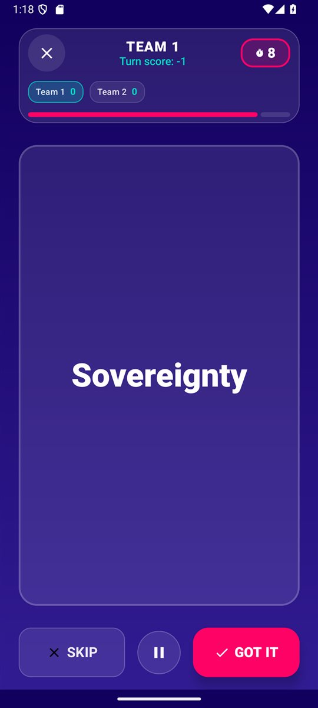
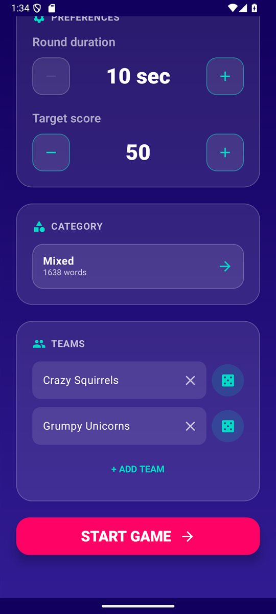
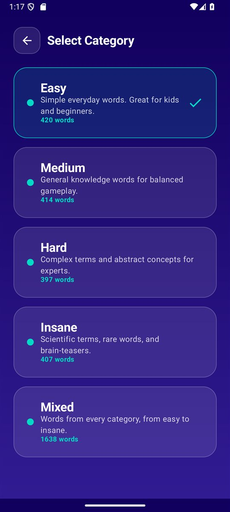
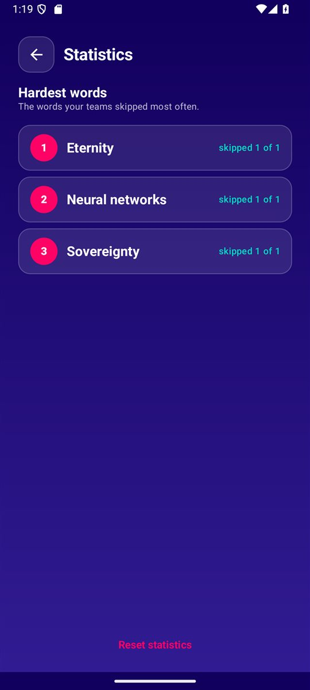
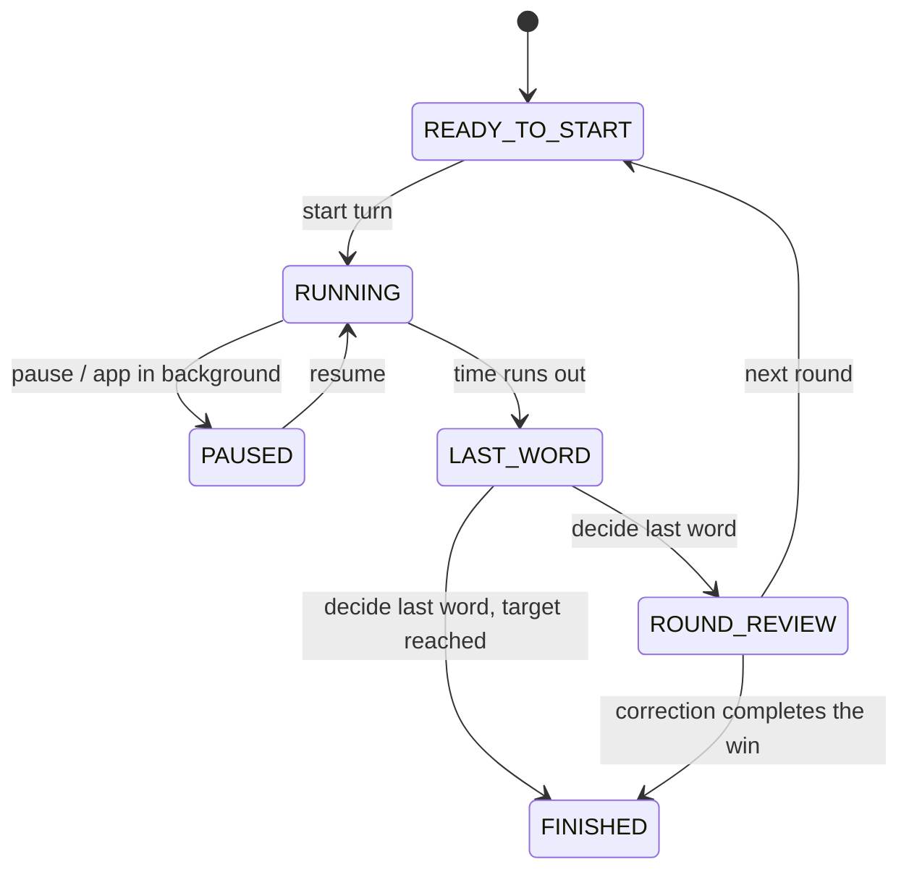
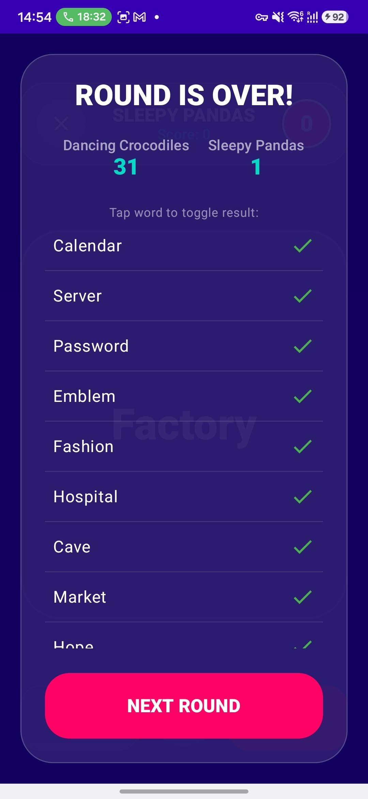

# Alias Game

[](https://github.com/QHailrakeQ/aliasgame/actions/workflows/android.yml)


[](LICENSE)

Alias Game is an Android party game inspired by the word-guessing game Alias: one player explains a word, their team guesses it before the timer runs out. It is built with **Kotlin** and **Jetpack Compose**, follows Clean Architecture, and is covered by unit, UI and CI checks.

<p align="center">
  
  
  
  
</p>

## Features

**Game setup**
- Round duration and target score with bounded steppers.
- Funny team names rolled at random from 50 names per language. Each name can be cleared or rerolled with one tap; blank and duplicate names are rejected before the game starts.
- Four languages (English, Ukrainian, Russian, German) for the interface, the words and the team names.
- Four difficulty categories of about 400 words each, plus a **Mixed** category with all ~1,600 words of a language. Every category shows its word count.
- **Themes** for every language: Cinema, Coffee shop, and Welding & NDT (non-destructive testing), about 400 words each.

**Playing**
- Timed turns with a countdown and a progress bar that turns pink in the last ten seconds.
- Mark words as guessed or skipped with vertical card swipes or the on-screen buttons.
- Pause and resume at any time; the countdown also pauses when the app goes to the background.
- When time runs out, the last word can be awarded to any team or to nobody.
- A round review lets the team correct any result before the next team plays.
- Fair finish: every team gets the same number of turns, and teams tied at the top win together.

**Around the game**
- **Statistics:** the 20 words your teams skipped most often, per language, with a confirmed reset.
- **Resumable games:** an interrupted game, even one killed by the system, is restored in the same state.
- Optional sound effects and haptic feedback; all preferences persist across restarts.

## Tech Stack

| Area | Choice |
|---|---|
| Language | Kotlin 2.0 |
| UI | Jetpack Compose, Material 3 |
| Architecture | Clean Architecture layers in one Gradle module, MVVM in the presentation layer |
| Dependency injection | Hilt |
| Asynchronous state | Kotlin Coroutines and Flow |
| Persistence | Jetpack DataStore Preferences, kotlinx.serialization |
| Navigation | Navigation Compose |
| Localization | Android resources with plurals, AppCompat per-app locales |
| Testing | JUnit 4, kotlinx-coroutines-test, Compose UI tests |
| CI | GitHub Actions with an Android emulator |

## Architecture

The `:app` module is organized into three layers:

- **Presentation:** Compose screens and ViewModels that expose an immutable UI state and one-off effects.
- **Domain:** models, use cases, repository interfaces, the framework-free `GameEngine` and pure rule objects (`WordStatistics`, `TeamNames`).
- **Data:** repository implementations for DataStore (settings, game session, word statistics) and the JSON word packs.

This is a layered structure inside one Gradle module, not a multi-module project.

### Game state machine

A game is always in exactly one `GamePhase`, and `GameEngine` owns every transition:



Every engine command is validated against the current phase, so stray or repeated taps cannot put the game into an invalid state. The engine has no Android dependencies and is covered by plain JVM tests.

### Game sessions

The setup screen starts a game by saving a fresh session snapshot; the game screen's ViewModel creates its own `GameEngine` from the saved session. Starting a new game and restoring one after process death therefore follow the same code path. A turn that was running when the app was killed is restored paused.

### Word statistics

When a team leaves the round review, each word of the turn is counted once as shown and, if it was not guessed, as skipped. Counting after the review means manual corrections are respected. The ranking (most skips first; on a tie, the word shown fewer times) lives in a pure domain object and is unit-tested.

### Words and languages

Word packs are bundled as one JSON asset per language, read off the main thread and cached. The Mixed category is built from the difficulty packs, so it needs no file of its own. Themes are plain JSON word lists in `assets/themes/<language>/`, discovered at runtime: adding a theme means adding a file to each language folder (a unit test checks that all languages offer the same themes). The app language is applied with AppCompat per-app locales, and team names are read from the same localized resources, so they always match the chosen language.

## Testing

**Unit tests** (`app/src/test`, 118 JVM tests):

- `GameEngine`: scoring, turn rotation, fair play, draws, last-word decisions, result corrections, dictionary reshuffling, every phase transition and rejection of out-of-phase commands.
- ViewModels: the countdown, pause and resume, background pause, double-tap safety, session restoring, recording word statistics, team-name rolling, validation and language switching.
- Domain rules: word statistics ranking and team-name generation and validation.
- Data layer: word-pack and theme parsing (including validation of every bundled asset), pack catalog with the mixed category and themes, session and statistics encoding, migration of sessions saved by older versions.

**Instrumented tests** (`app/src/androidTest`, 10 Compose UI tests):

- Smoke tests for the home → rules, settings, statistics and setup → game flows, including the exit confirmation.
- Overlays block touches and accessibility focus on the controls underneath, while their own buttons still react to a real, slightly moving finger.
- The countdown pauses when the app goes to the background.

```bash
./gradlew lintDebug testDebugUnitTest   # lint and unit tests
./gradlew connectedDebugAndroidTest     # UI tests (emulator or device required)
```

## CI/CD

GitHub Actions automates checking and releasing:

- **Android CI** (`.github/workflows/android.yml`) runs on pushes to `main` and `feature/*` and on pull requests. Two jobs run in parallel: *Lint, unit tests and build* (`lintDebug`, `testDebugUnitTest`, `assembleDebug`, with the APK kept as an artifact) and *UI tests* (`connectedDebugAndroidTest` on a KVM-accelerated API 29 emulator with a cached snapshot). Gradle is cached, a newer push cancels an outdated run, and reports are uploaded when a job fails. Pull requests into `main` can only be merged when both jobs pass.
- **Release** (`.github/workflows/release.yml`) runs when a version tag is pushed: it runs lint and unit tests, builds the APK and publishes a GitHub Release with notes generated from the merged pull requests.
- **Dependabot** proposes weekly updates of Gradle dependencies and GitHub Actions.

```bash
git tag v1.2 && git push origin v1.2   # publishes release 1.2
```

## Screenshots

<table>
  <tr>
    <td align="center"><strong>Ready to start</strong><br></td>
    <td align="center"><strong>Last word</strong><br></td>
    <td align="center"><strong>Round results</strong><br></td>
    <td align="center"><strong>Game winner</strong><br></td>
  </tr>
</table>

## Getting Started

1. Clone the repository.
2. Open the project in Android Studio (JDK 17 for Gradle).
3. Sync the project and run the `:app` module on an emulator or a physical device.

## Roadmap

- [ ] Target Android 15 (API 35) with edge-to-edge layouts.
- [ ] "Continue game" on the home screen for a saved session.
- [ ] Localized error messages and plural forms for scores.
- [ ] Save the session on meaningful events instead of every countdown tick.
- [ ] Complete the Russian *Insane* word pack.

## License

Released under the [MIT License](LICENSE).
